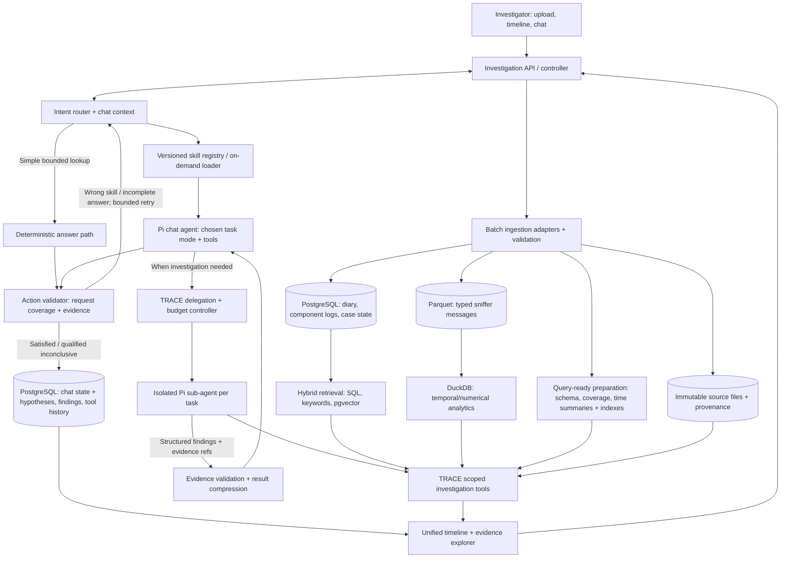

i g# TRACE — Architecture & Agent Harness

**TRACE** = **Timeline Reconstruction, Analysis, Correlation & Explanation**
**Status:** working architecture / source of truth for the repository
**Updated:** 2026-10-13 (finalized four-skill catalog + shared evidence capability; retained dynamic loading, feedback loops and delegated Pi harness)
**Replaces:** earlier TRACE architecture drafts where they conflict

> **Core idea:** TRACE is an evidence-driven chat and investigation system over historical multi-component sensor logs. Users may request quick factual status, health summaries, timeline explanations, numerical comparisons, or full root-cause investigations. A lightweight router selects task-specific skills on demand; deep investigations use Pi-based main/sub-agents and deterministic tools to establish what happened and why. TRACE is **not** simply a chat-over-logs RAG application.

## 1. Requirements and factual constraints

### Scope and workflow

1. **Batch ingestion:** investigator uploads source files selected for an incident; no live stream is required initially.
2. **Intent-aware chat:** the user asks questions in natural language: direct sensor status at an hour, which systems were unhealthy, event/timeline summaries, numerical comparisons, or full investigations into why a failure occurred. The system must **not** automatically interpret every question as a root-cause investigation. Follow-ups inherit relevant time/source context.
3. **Outputs:** concise factual answers for simple questions; time-aligned timeline, numerical comparisons, hypotheses and conclusions for more complex tasks; clickable evidence and explicit uncertainty in all modes. A root-cause hypothesis is **not** required for a status lookup.
4. **System:** sensor/radar hardware, external sensors, network message flows, frontend and backend services, and other components may all contribute evidence.
5. **Scale:** short investigations may cover ~10 minutes; complex ones may cover hours (earlier planning also allowed 14–16 hours across two days). Files may be several GB. For illustration, five types × 100 targets × 1–2 messages/second × two hours yields **3.6–7.2 million messages**, *if all five types really occur at those per-target rates*. Actual sizes and rates remain to be measured.
6. **Expansion:** new logging systems, message types, independent investigations, and larger data volumes must not require rewriting the agent.

### Exactly three source families

| Family | Shape | Key needs |
|---|---|---|
| **Diary** | Excel or equivalent: reported timestamp + human-authored **free text**, often Hebrew | Text/semantic retrieval, approximate event time, possible delayed writing; do not assume the entry's creation timestamp is known |
| **Component/system logs** | **TXT files:** timestamp + irregular free text, produced by sensor hardware, subsystems and microservices | Per-component startup/runtime styles; time/source filters, exact error-code search, time-filtered semantic search, state/error correlations |
| **Sniffer** | **CSV export** of typed, predefined messages exchanged by subsystems | Message/field discovery, high-volume time-series queries, typed comparisons, anomalies, sequence and coverage checks |

**Critical sniffer fact:** users deliberately select **which message types, fields, targets and/or filters** they export. A CSV is *not* necessarily a complete capture. TRACE must preserve the selection/coverage manifest or label it **unknown**. No record in an export does **not** imply the system never emitted it.

The CSV format is established; exact headers, layout for multiple message types, timestamp semantics, units and export metadata availability are **not yet established**. Do not fabricate those details.

### Hackathon constraints retained

Original plan: **21 hours, five developers**, synthetic/approved data only in an accessible cloud environment, one strong end-to-end demo; later migrate to closed-network/local-model deployment. No real restricted data, system identifiers, internal protocol definitions or thresholds may be copied into cloud prompts or examples. Treat 21h as the original timebox, not a guaranteed current schedule.

## 2. Decisions vs. hypotheses

### Architectural decisions

- **One logical event model, multiple specialized physical representations**: common metadata for all sources; preserve message-specific typed fields and original source rows.
- **Two retrieval capabilities**: (A) temporal/structured/numeric analytics; (B) lexical + semantic retrieval for human/machine text, always respecting investigation/time/source metadata.
- **Agent chooses investigative operations; deterministic code does computation.** Never send millions of rows to the LLM.
- **Stable evidence references** link every observed or derived claim to original files/rows and reproducible computations.
- **Coverage, timestamp uncertainty, units and confidence limitations** are explicit, not afterthoughts.
- **A small versioned system knowledge catalog** defines message meanings, field units, component relationships, and testable expectations.
- **Intent-aware chat router + four dynamically loaded skills** (`health-status`, `timeline-summary`, `signal-analysis`, `root-cause-investigation`) determine each turn’s workflow. Evidence explanation is a shared capability, not a fifth skill. A short permanent policy describes tool/evidence rules; detailed skill instructions load only as needed. Full investigations are **not** the default for simple factual requests.
- **Action validation + bounded feedback** checks the actual result against the user's original question, requested scope and required evidence; a wrong/incomplete action may be corrected or re-routed without starting an unrequested root-cause investigation.
- **Main investigator + bounded, isolated investigation sub-agents** remains the deep-investigation design. Sub-agents perform focused exploratory retrieval and analysis, return compact evidence-backed findings, and do not share their raw histories with the main agent. Benchmark it against direct tool calls; deterministic application lookups need no extra LLM.

### Agreed initial stack (implement both retrieval paths from the start)

| Responsibility | Chosen technology | Use in TRACE |
|---|---|---|
| High-volume **sniffer CSV** analytics | **Parquet + DuckDB** | Parse/validate CSV → typed, time-organized Parquet; query message types, target IDs, timestamps and selected numeric fields; compute deltas, comparisons, gaps and aggregations |
| **System logs and human diary**, plus application metadata | **PostgreSQL** | Store timestamped free-text records, investigation/file metadata, capture manifests, catalog, sessions, hypotheses, tool calls, evidence references and approved findings |
| **Semantic retrieval** for text | **pgvector extension in PostgreSQL** | Store embeddings for suitable diary/system-log texts; combine vector similarity with time/source filters and exact keyword/error-code matching |
| **Agent runtime** | **Pi `@earendil-works/pi-agent-core`**, backed by `@earendil-works/pi-ai` | Pi supplies tool-calling loops for main/task agents; TRACE supplies a **chat intent router, versioned skill registry/loader, task-specific tool access, action validation/re-routing**, delegation, evidence handoff, state and verification |
| Original evidence | **Immutable uploaded files** | Retain exact CSV/log/diary originals, hashes and row locators; all derived indexes/datasets can be rebuilt |

**These are the chosen initial components**, not a menu of mutually exclusive alternatives. PostgreSQL + pgvector is one database service with an extension; DuckDB is an analytical engine reading Parquet, not a separate vector database. BigQuery is **not** in the initial stack. Revisit it only if deployment rules or measured scale make a managed cloud warehouse preferable.

Use **one shared investigation/evidence contract** above both data paths. PostgreSQL may hold the case/source metadata, while millions of sniffer rows stay in Parquet; no need to duplicate all sniffer rows into PostgreSQL. The timeline and agent use the same scoped query services, not direct database-specific assumptions.

**Why this split:** DuckDB is optimized for scanning and calculating across selected columns of large structured datasets. PostgreSQL is suitable for text, indexed filters and transactional workflow state; pgvector adds semantic similarity but **does not understand language on its own**. An embedding model is also required, and Hebrew/multilingual quality must be evaluated. Time filters, exact error codes and source IDs remain essential alongside embeddings.

## 3. Logical architecture



This is a **logical**, not microservice, diagram. The router picks a task mode before enabling investigation behavior; the agent is not permanently in investigator mode. The **action validator runs before any user-facing answer**, including deterministic lookup paths, and may request a bounded re-route or answer revision. It is distinct from the root-cause investigation loop. The application may answer bounded, straightforward status queries through deterministic read-only query services without spawning another LLM. **Exploratory, multi-step DB retrieval by the investigator remains delegated to isolated sub-agents.** A Node/TypeScript backend owns the router, Pi instances, tool permissions and controller, with DuckDB reads isolated in a managed analytical worker as needed.

**Two flows are distinct:** the *offline simulation/generation flow* produces source-like raw files plus hidden ground truth; the *runtime ingestion flow* consumes only those raw files, exactly as it will eventually consume real approved exports. See §9.

## 4. Unified event and source metadata

Minimum **logical event envelope**, regardless of which engine physically stores its detail:

```ts
interface EventEnvelope {
  investigationId: string;
  eventId: string;              // stable source-location based identifier
  sourceFileId: string;
  sourceFamily: 'diary' | 'system_log' | 'sniffer';
  sourceSystem?: string;
  eventType?: string;           // service event or sniffer message type
  eventTime?: string;           // normalized timeline anchor
  eventTimeEarliest?: string;   // for human-reported approximate times
  eventTimeLatest?: string;
  recordedTime?: string;        // only if genuinely available
  originalTimestamp?: string;
  correlationIds?: Record<string, string>; // target, track, service, message, etc.
  sourceLocator: { row?: number; byteOffset?: number; recordId?: string };
  schemaVersion?: string;
  severity?: string;
  text?: string;                // free text for diary/system logs
  // Source-specific structured payload exists in its own typed representation.
}
```

**Physical design cautions:**

- Do **not** insert all 7M sniffer records into PostgreSQL solely to give them a common timeline ID. The shared event index can be a *logical/federated query result*. A stable `(sourceFileId, originalRow/recordId)` reference can identify sniffer evidence stored in Parquet.
- Don't force all CSV message types into one giant all-null schema. Parse by message schema/export structure and preserve typed dynamic columns, as available; keep catalog definitions of field meaning/unit/coordinate frame.
- Separate `eventTime`, ingestion time, and human-reported occurrence time. Record source clock precision and clock-domain assumptions; don't invent timestamp corrections.
- Keep provenance: file hash, original file name, file type, parser and catalog versions, original row location, parse failures, capture start/end, filtered message types and fields, target filters, recorder completeness/drops where known.
- A file that omits a message type gives **no evidence about whether that type occurred**. Even a selected type may be incomplete if capture drops or filters are unknown.
- Unknown metadata should be represented as **unknown**, not implicitly complete.

## 5. Ingestion pipeline: efficient and reversible

1. **Register upload**: investigation ID, raw file hash, immutable original, source family, user-provided filter/coverage specification (if available).
2. **Inspect schema**: determine CSV header/layout/message types/field types, timestamp and locale; validate against versioned catalog where possible; never silently guess coordinate units.
3. **Process in batches/streams**: parse, normalize timestamps, extract keys, validate field values, record rejected/ambiguous rows. Avoid loading an entire multi-GB CSV into application RAM.
4. **Write structured data**: sniffer to typed Parquet organized by investigation/message type (or another measured layout); sort/cluster by timestamp where worthwhile. Avoid huge numbers of tiny files.
5. **Write PostgreSQL records**: store diary and service entries with timestamp/source/entity fields, plus investigation and coverage metadata; index relevant time and identifier columns. Do not embed numerical sniffer rows by default.
6. **Build keyword and pgvector retrieval indexes**: preserve exact terms/error codes and generate embeddings for selected diary/system-log entries using an approved multilingual embedding model evaluated on Hebrew. Deduplicate/template repetitive service logs where possible, while retaining references to all original occurrences. Embedding jobs may run asynchronously after lexical/time-indexed retrieval becomes available; expose index readiness to the agent.
7. **Build orientation/coverage summaries**: time ranges, counts by source/message/time bucket, available fields, parse errors, known capture gaps and obvious numerical statistics. Compute expensive domain anomalies only when rules are available or the investigation requests them.
8. **Publish ingestion report**: state exactly what is queryable, what source data was excluded or may be missing, and which indexes/embeddings are ready.

**Efficiency note:** DuckDB/Parquet can limit the columns and row groups scanned for well-laid-out time filters. This is not a magic index on arbitrary CSV: the on-disk organization and query shape determine pruning. Separately, result pagination, aggregations and concise tool responses control **LLM context usage**.

## 6. Two retrieval paths, one evidence contract

### A. Structured / temporal / numeric tools (DuckDB)

Input examples: case ID, message type, time interval, target ID, validated field paths, operation and bounded result format. Examples: field min/max, largest delta per second, compare GPS/manual/external position, target-wise trend, window counts, expected sequence latency.

The agent should normally see **small computed summaries**, suspicious ranges and evidence handles; not a dump of all sample rows. Individual originals are opened only when needed.

### B. Hybrid retrieval for diary and irregular logs (PostgreSQL + pgvector)

1. Scope every query to **investigation ID**, and use a relevant time window, source/service, target or related components when available. Avoid forcing a narrow time window when the user reports uncertain times.
2. Search **exact identifiers/terms** (error codes, service names, track IDs) and **semantic meaning** (natural-language descriptions via pgvector). Merge/deduplicate and optionally rerank results.
3. Return top-K original entries with time, source, evidence ID, text excerpt and coverage/uncertainty, plus a paginated continuation path.
4. Allow the agent to expand the time window or traverse system components if the initial search finds nothing.

**Performance nuance:** `WHERE` clauses with pgvector approximate indexes are not always physically evaluated *before* ANN matching; some index strategies filter after candidates are scanned. For selective time windows, consider indexed SQL prefilter + **exact vector ranking of the resulting small subset**. Benchmark exact-vs-ANN recall/latency instead of assuming “metadata-first” is free.

**Accuracy nuance:** a semantic hit is a candidate *record*, not proof of a causal link. Check exact times/IDs, original text, and relevant contradicting evidence.

## 7. TRACE investigation harness: main investigator + delegated sub-agents

### 7.0 Intent-aware chat and on-demand skills (agreed change, 2026-10-13)

**Problem:** A single large, always-on investigation system prompt is both expensive in context and behaviorally wrong. A user can ask for a fact ("What was sensor A's status at 14:03?"), a fleet/system health overview ("Which components were down between 14:00 and 14:10?"), or a causal investigation ("Why was the target not detected?"). Those requests should not all trigger hypothesis formation or repeated sub-agent delegation.

**Architecture:** Keep a small permanent *chat coordinator* policy, an **intent/mode router**, and a **versioned skill registry**. A skill is an on-demand set of task-specific instructions, method, output expectations and optional references; it is **not** a database, a model, or a tool implementation. Tools are TypeScript services that actually retrieve or compute data. Skills teach the agent **when and how** to use them. A skill may request a tool profile; the backend independently enforces the permitted tools and query scope.

#### 7.0.1 Agreed initial skill catalog (four skills)

The **initial catalog is finalized for implementation**, though it may evolve after evaluation. Skills describe *different workflows*, not different data sources or individual query variants. A single sensor and a fleet-wide health question use the **same skill** with a different `entityScope`.

| Skill ID | Example requests | Behavior and default execution |
|---|---|---|
| `health-status` | "Was sensor A working at 14:03?" / "Which systems were unhealthy then?" | Look up and correlate observed component health, errors and transitions. Accept `entityScope: single / specified / all_available`; distinguish healthy, degraded, down and unknown. Bounded queries and aggregation; **no automatic root-cause investigation**. |
| `timeline-summary` | "What happened between 14:00 and 14:05?" | Summarize events chronologically across selected sources, using time buckets and evidence references. Explain noteworthy transitions and gaps **without asserting a cause** merely from temporal proximity. |
| `signal-analysis` | "Did the external position jump relative to GPS?" | Discover typed fields/units, align time series and run deterministic comparisons, statistics and anomaly checks with DuckDB. Use a focused sub-agent only when multistep interpretation is required. |
| `root-cause-investigation` | "Why did the radar miss the target?" | Form competing hypotheses, delegate bounded tasks to Pi sub-agents, verify evidence and contradictions, then conclude or explicitly abstain. **Only this skill activates the full investigation loop.** |

**Shared capability — evidence lookup/explanation (not a skill):** A request such as "Show the original log" or "How was this delta calculated?" resolves existing, authorized evidence and explains its provenance using `get_evidence` and stored analytical results. It inherits the active case and relevant evidence handles; it should **not** launch a new causal investigation unless the user's request changes to one. Evidence access and citation checks are also available within *every* skill.

**Skill composition:** route to one primary skill by default. For requests that genuinely require two methods (e.g., "plot the jump and explain why it happened"), compose a bounded `signal-analysis` task with `root-cause-investigation` rather than loading all four skills. Follow-ups reuse explicit case/time/entity context, not accumulated skill prompts.

#### 7.0.2 Routing, context and lifecycle

1. **Receive the turn:** use user text plus a compact, structured chat state: selected case, last source/target, last time range, active task and evidence handles. Do not infer missing information from another case.
2. **Route intent:** prefer explicit user intent, obvious deterministic rules for clear cases, and a small model-based classifier/agent decision for ambiguous cases. Router output is validated (`mode`, `skillIds`, `timeWindow`, `entities`, `entityScope`, `requiresClarification`, `confidence/uncertainty`). Skill IDs are restricted to the four approved entries; evidence-only follow-ups use shared evidence resolution without selecting a fifth skill. If essential scope is ambiguous, ask one targeted question; do not silently launch a major investigation.
3. **Load on demand:** inject the chosen versioned skill instructions/references for this task, within a token budget. The permanent coordinator carries the four skill *names and one-line descriptions*, shared evidence-resolution behavior and universal rules: source scope, trustworthy evidence, no unsupported absence/causality, and a short response by default.
4. **Expose only relevant tools:** tool permissions are set by the controller, never conferred simply because a skill text requests them. Status mode needs read-only lookup/aggregation; investigation mode may delegate. No unrestricted SQL, shell or arbitrary file access.
5. **Execute:** status and summary paths produce a draft evidence-backed answer; root-cause mode invokes the outer delegate → validate/compact → update hypotheses → continue/stop loop (§7.1). Never create an `InvestigationState` with hypotheses just because a user asked for sensor status.
6. **Validate the action before responding (§7.0.3):** compare the draft *and its tool/evidence results* with the **original user request**. Return a supported answer, a qualified inconclusive answer, or a bounded revision/re-route; a skill returning successfully is not sufficient.
7. **Persist task state without bloating context:** retain a short chat summary, active skill/mode, skill version, normalized filters, evidence links, action-validation outcome and (only where applicable) investigation hypotheses. Store full traces separately. On a follow-up, **re-route** using the new question and existing scope; switch skills if the user changes task.

**Important context-lifecycle rule:** loading a skill into a Pi transcript does not necessarily remove it from later prompts; a naive implementation that appends a new system message for every selected skill could grow context indefinitely. Build each turn/mode from a **bounded current skill context + concise persisted chat facts/recent turns** (or explicitly compact/rebuild transcript state using supported Pi APIs). Keep the full history/evidence in PostgreSQL, not in every model prompt. During a multi-step root-cause run, retain the active skill until that task completes, then summarize/persist and release its instruction context before another mode. Verify this behavior with context-token measurements and mode-switch tests.

Example conversation progression:

```text
User: "What was radar sensor status at 14:03?"
  -> health-status (entityScope=single) -> retrieve state and evidence -> concise answer
User: "Which other systems were unhealthy then?"
  -> health-status (entityScope=all_available) -> reuse 14:03 window -> list states
User: "Why did the detection fail?"
  -> root-cause-investigation -> reuse relevant findings -> delegate, investigate and verify
User: "Show the log that supports that."
  -> shared get_evidence / explanation -> inspect cited record; no new causal loop
```

#### 7.0.3 Action validation and bounded feedback (required)

**Why:** Intent routing can select the wrong skill **or the correct skill with the wrong scope**. Example: "Which systems were unhealthy at 14:03?" routed to `health-status` with `entityScope=single` returns only one sensor. A valid sensor reading is **not** a complete answer about all systems. TRACE must validate *task coverage*, not simply successful tool execution.

**This is a different loop from root-cause investigation.** The action-validation loop asks **"Did we take an appropriate action and address the user's request?"** The optional deep-investigation loop (§7.1) asks **"Have we found sufficient evidence to explain the cause?"** Only an explicitly causal user request or a user-approved change of task activates the latter.

```text
USER REQUEST + inherited, confirmed chat scope
   -> Route to candidate skill(s) and define required answer coverage
   -> Execute bounded tool/skill workflow; produce draft + evidence references
   -> ACTION VALIDATOR compares result against ORIGINAL request/requirements
       -> SATISFIED: return supported answer
       -> SUPPORTED BUT DATA INSUFFICIENT: return qualified unknown/inconclusive
       -> INCOMPLETE DRAFT: reuse evidence, revise answer or fetch missing scope
       -> WRONG SKILL / WRONG SCOPE: re-route using unmet requirements
       -> ESSENTIAL AMBIGUITY: ask one focused clarification
   -> At most 2 automatic corrections/re-routes; otherwise report limitations
```

**Validation contract (illustrative; controller-owned, not the model's unrestricted judgment):**

```ts
type ActionOutcome =
  | 'satisfied' | 'insufficient_evidence' | 'revise_answer'
  | 'reroute' | 'clarification_required';

interface RequestedAnswer {
  originalQuestion: string;                  // stable across retries
  investigationId: string;                 // enforced by backend
  requestedTime?: { start: string; end: string };
  requestedEntities?: string[];
  entityScope: 'single' | 'specified' | 'all_available';
  answerKind: 'health' | 'timeline' | 'signal' | 'cause' | 'evidence_followup'; // evidence is a shared capability
  mustCover: string[];                     // e.g., each available system, not one sensor
  selectedSkillIds: string[];              // version-pinned
}

interface ActionValidation {
  outcome: ActionOutcome;
  unmetRequirements: string[];
  evidenceProblems: string[];
  supportedUnknowns: string[];             // gaps in capture/observability
  nextSkillIds?: string[];                 // only for reroute, allowlisted
}
```

1. **Before execution:** the router/controller establishes a compact `RequestedAnswer` from the actual user request and inherited case/time scope. It never allows the selected skill to redefine or narrow the user's question unnoticed. Check that available source coverage could plausibly satisfy the request.
2. **Deterministic checks first:** compare requested entity coverage (one sensor vs *all systems*), time window, filter scope and output fields; validate case-bound evidence IDs and calculated-result references; enforce read-only tool access, budgets and coverage-aware absence claims. "No matching log" is not proof of a healthy or failed system.
3. **Optional semantic check:** when semantic completeness cannot be checked mechanically, a small evaluator may compare the *original question*, required answer coverage, structured tool outputs and draft answer. Its typed verdict is **advisory**: it cannot invent evidence, expand permissions, silently change the objective or override deterministic failures.
4. **Correct cheaply:** prefer answer revision or a missing bounded lookup using already verified findings; only re-route if the selected skill's workflow was genuinely wrong. Reuse compatible retrieved evidence, not entire sub-agent histories. Do not launch expensive root-cause investigation for a status/health request merely because a status is unknown.
5. **Bound the loop:** a **default maximum of two automatic repair attempts per user turn**, with token/tool/time ceilings, stable case authorization and repeated-action detection. After limits are exhausted, provide the supported partial answer or one clarification rather than looping indefinitely.
6. **Record outcomes:** persist original intent, chosen skills/versions, validation verdict, unmet requirements, attempts, reused evidence and final disposition for auditing and routing evaluation. Never store generated reasoning as substitute for verified facts.

**Example:** "Which systems were down at 14:03?" → `health-status` mistakenly runs with `entityScope=single` → validator flags the unmet `all_available` coverage → retry **the same skill with corrected scope**, reusing evidence → distinguish **down**, **degraded**, **healthy** and **unknown/uncaptured** components → validate and respond. Re-route to a *different* skill only if the user’s actual task requires a different method. If exports cannot establish every status, say so; a qualified unknown is a valid answer.

#### 7.0.4 Skill packaging and Pi integration

Use a repository skill layout based on the portable `SKILL.md` convention, with narrowly scoped text and optional reference files:

```text
trace/skills/
  health-status/SKILL.md
  timeline-summary/SKILL.md
  signal-analysis/SKILL.md
  root-cause-investigation/SKILL.md
trace/harness/
  intent-router.ts
  skill-registry.ts
  skill-loader.ts
  tool-profiles.ts
  action-validator.ts
  action-repair-controller.ts
  chat-controller.ts
  evidence-resolver.ts        # shared by all skills and evidence-only follow-ups
```

A `SKILL.md` begins with `name` and `description` frontmatter and includes purpose, triggers/non-triggers, workflow, output contract, evidence/coverage requirements, and short examples. Put large domain references in linked files loaded only if needed. Keep **machine-enforced tool allowlists, budgets and tenant/case access rules in TRACE configuration/code**, not trusted Markdown instructions.

**Pi distinction:** The full **Pi Coding Agent** provides built-in skill discovery/on-demand loading. The agreed TRACE runtime, **`pi-agent-core`**, provides agent/tool loops and configurable state/tools but **does not automatically implement Pi Coding Agent's skill registry**. Implement our own lightweight registry, router and contextual instruction loading on top of Agent Core. If we later choose to embed the Coding Agent SDK, re-evaluate its skill loader rather than assuming identical APIs. Follow the currently installed Pi version's supported system-message and tool-state mechanisms; avoid blindly mutating/replacing entire system prompts after each turn.

#### 7.0.5 Evaluation and safeguards

- Add scenario questions for all four skills and **multi-turn transitions**, not just root-cause questions. Include deliberate misroutes and scope errors: single sensor vs all systems **within `health-status`**, "what happened" vs "why", numeric comparison vs causal explanation, and citation-only follow-up vs fresh investigation.
- Measure **initial routing accuracy, final task-satisfaction after correction, inappropriate re-route rate, number of repair attempts, evidence/coverage correctness**, number of unnecessary investigations/sub-agents, latency and **total** context tokens (including skill instructions, validation and sub-agents).
- Include a **negative test** in which evidence is missing: the validator must accept a correctly qualified unknown/inconclusive answer instead of continually forcing new skills or fabricating a result.
- Verify that a failed deterministic check cannot be overruled by a semantic LLM verdict, and that follow-up turns carry forward only relevant case/time scope.
- Make answers distinguish **operational state**, **logged errors**, and **unknown/unobserved state**; a log search with no hit is not proof a system was healthy.
- Treat uploaded logs, diary text and all retrieved records as **untrusted evidence**, never as instructions to the router, skill loader or agent.
- Keep the skill registry versioned and pinned to a task for reproducible evaluations. Router/skill changes must not expose hidden generator ground truth.

#### 7.0.6 Final skill boundaries and expansion rules

**Decision:** Implement exactly the four approved skills in §7.0.1 initially. We do **not** implement separate `sensor-status`, `system-health`, or `evidence-explanation` skills.

| Design choice | Reason |
|---|---|
| Merge sensor and system status into `health-status` | Same state/coverage method; only `entityScope` and filters change. |
| Keep `timeline-summary` | Its output contract is an evidence-backed chronology, not an assessment of component health or causality. |
| Keep `signal-analysis` | Typed fields, units, temporal alignment and deterministic numerical methods require separate instructions. |
| Keep `root-cause-investigation` | Distinct multi-step hypotheses, delegated sub-agents, contradiction checks and stopping criteria. |
| Share evidence lookup/explanation | Cross-cutting evidence service/interaction, not a separate workflow; preserve original record and derived calculation provenance. |

**When to add a new skill:** only after scenario evaluation reveals a repeatable workflow with materially different decision rules, tool permissions or output/evidence contracts. Different components, message types, source families and query sizes are normally **parameters**, not new skills. Keep routing and action validation versioned so a future skill can be introduced without changing existing contracts.

### 7.1 The *root-cause* loop and division of responsibility

```text
USER QUESTION (routed to `root-cause-investigation` by §7.0)
  -> TRACE controller initializes InvestigationBlackboardState (CTR-04)
  -> MAIN INVESTIGATOR ORCHESTRATOR (Pi ReAct Loop):
     1. Exploratory Fact-Finding:
        - Query incident boundary context, error logs, and state transitions
        - If initial facts are insufficient to understand symptoms, CONTINUE fact gathering (widen window, check adjacent feeds)
     2. Grounded Competing Hypotheses:
        - Once baseline facts exist, formulate candidate causes (H1 vs H2) grounded in empirical data
     3. Targeted Delegation & Dynamic Evolution:
        - Delegate bounded tasks to isolated Pi Sub-Agents (backward search for onset, forward search for propagation)
        - Receive compressed findings with CTR-05 source locators
        - DYNAMIC RE-EVALUATION: If evidence contradicts H1, mark REFUTED, backtrack, or evolve H3
     4. Termination & Exhaustion:
        - Conclude when primary cause is corroborated across independent sources with rival theories refuted
        - If all logical sources in the archive are exhausted without corroboration, declare explicit ABSTENTION
  -> TRACE validates final references and displays evidence-backed answer
```

**Dynamic Blackboard & Working Memory:**
The Main Investigator maintains an active `InvestigationBlackboardState` containing `established_facts`, `working_hypotheses`, `open_leads`, and `exhausted_sources` (streamed to Lane 5 UI via `event: blackboard_update`). It is a true orchestrator, not a rigid sequential pipeline:
- **Fact-finding can take multiple iterations** before any hypothesis is proposed if initial observations are thin.
- **Hypotheses are living theories**: they can be supported, refuted, discarded, or synthesized as new evidence surfaces.
- **Backtracking is supported**: if a lead goes cold (e.g. 0 packet drops), the orchestrator retreats to its open leads list and pursues the next logical angle.

**One sub-agent per bounded investigative task, not per SQL query.** For example, a task to compare external/GPS/manual position from 14:02–14:04 may require several DuckDB operations, a targeted log lookup and inspection of original records. Each sub-agent has a separate conversation/context and can be disposed of after returning its results; its complete tool trace is retained in the backend for audit/replay, not inserted into the main model's context.

**Backward search is a tactic, not the loop itself.** The main investigator can move backward to identify onset and forward to establish propagation. It must check multiple hypotheses rather than latching onto the nearest error line.

### 7.2 Who gets which tools?

| Caller | Exposed operation | Responsibility |
|---|---|---|
| **Main agent** | `delegate_investigation` | Create task with a question, eligible sources, relevant time window, investigation/target scope, bounded budget and expected answer format |
| **Main agent** | `submit_findings` (optional agent-facing operation) | Request final validation of observations, hypotheses and supporting references; the validator, not the LLM, decides whether required fields/references are present |
| **Controller (no LLM needed)** | `load_case_overview`, `load_state`, `persist_state` | Preload orientation metadata, approved catalog, ongoing hypotheses and recent verified findings |
| **Sub-agent** | `get_case_overview` | Available sources, coverage, counts, parse warnings and fields, scoped to its delegated task |
| **Sub-agent** | `describe_message_type` | Field units, coordinate systems, producer/consumer, timing and correlation semantics |
| **Sub-agent** | `query_events` / `summarize_window` | Bounded time/source/target queries, aggregations and paged results (DuckDB and/or PostgreSQL) |
| **Sub-agent** | `search_text` | Time-filtered exact/keyword + semantic search of component logs and diary (PostgreSQL + pgvector) |
| **Sub-agent** | `analyze_fields` | Typed numerical comparisons, jumps, rates, alignment and gaps (DuckDB) |
| **Sub-agent** | `trace_entity` / `check_expectation` | Cross-component propagation and expected follow-ups, qualified by capture coverage |
| **Sub-agent** | `get_evidence` | Open original rows/lines, surrounding context or stored analysis by trusted evidence handle |

The named operations are **initial capability contracts**, not a requirement to create a tool for every calculation. TRACE implements all SQL, file reads, calculations and indexes behind read-only, input-validated services. Never expose unrestricted SQL, shell access or arbitrary paths to either agent. During **root-cause mode**, the main agent generally **does not have direct exploratory DB tools**; it delegates focused investigations to keep large raw results outside its context. Simple, non-exploratory chat modes can use deterministic application lookups without another LLM. The UI and validation services can query databases directly without an LLM.

### 7.3 Delegated-task and result contracts (conceptual TypeScript)

```ts
interface DelegatedInvestigationTask {
  taskId: string;
  investigationId: string;       // bound/verified by backend, not model trust
  question: string;              // single, testable investigative question
  timeWindow?: { start: string; end: string };
  sourceIds?: string[];
  targetIds?: string[];
  allowedToolNames: string[];
  budget: { maxToolCalls: number; maxRowsPerCall: number; maxTokens: number };
}

interface InvestigativeFinding {
  observation: string;
  evidenceRefs: string[];        // source row(s) or a persisted analytical result
  significance: 'high' | 'medium' | 'low';
  kind: 'observation' | 'calculation' | 'absence_check' | 'hypothesis';
}

interface SubAgentResult {
  taskId: string;
  status: 'completed' | 'inconclusive' | 'budget_exhausted' | 'error';
  findings: InvestigativeFinding[];
  contradictions: InvestigativeFinding[];
  negativeFindings: InvestigativeFinding[];
  coverageLimitations: string[];
  unresolvedQuestions: string[];
  proposedNextSteps: string[];
  evidenceRefs: string[];
}
```

**Deterministic handoff:** validate schema, investigation scope, allowable evidence IDs, recorded analysis parameters, time/field units and tool budgets. Record the full sub-agent trace separately; pass the main agent only a small bounded result. Explicitly retain important negative findings and contradictions, not just highly relevant positive matches. A valid evidence ID establishes provenance, **not automatically that the associated causal interpretation is correct**. Contradictions and causal claims still require cross-checking.

**Failure behavior:** on schema failure, exhausted budget, missing sources or ambiguous capture, return a typed incomplete/inconclusive result rather than inventing a conclusion. Retries are bounded. Never equate “no search hit” with “event did not happen.”

### 7.4 Persistent investigation state and stopping rules

Store in PostgreSQL both **chat task state** (case/source/time focus, last active skill, skill version, evidence handles, brief context) and, only during diagnosis, **investigation state** (original question, active hypotheses and predictions, observations, contradictions, coverage notes, delegation tasks, budgets and unresolved questions). Main-context summaries can be rebuilt from persistent facts without copying sub-agent transcripts or permanently loading all skill instructions.

After **every completed sub-agent task**, the main agent must update hypotheses and choose one of: (a) another focused task; (b) a widened/narrowed investigation; (c) a conclusion; or (d) an inconclusive answer. A controller enforces call/token/time limits and verifies final evidence refs. Avoid unverifiable numeric confidence; explain confidence qualitatively with supporting and missing evidence.

### 7.5 Versioned system knowledge catalog

Define component topology, message producers/consumers, field paths/units/coordinate frames, clock meaning, correlation keys, message-follow-up expectations, valid sampling rates, thresholds and known sensor resets. **This is not hidden ground truth.** The investigator may read generic, approved system definitions and expectations, but must never see the simulator's injected fault or causal answer.

### 7.6 Optional decision model (not baseline dependency)

A JEV-/Laya-style decision model may later **rerank or classify bounded candidate log results** within `search_text` (e.g., relevance to the current task, candidate symptom vs unrelated noise). Compare its recall, missed critical evidence, cost and latency against ordinary hybrid retrieval first. Do not let a relevance classifier permanently delete rows, adjudicate causality or replace numeric analysis. No model is required for the initial simulation and harness milestones.

## 8. Pi Agent Core integration (agreed runtime)

Use **Pi's libraries**, not the interactive coding-agent CLI, for the **chat agent and its task-scoped sub-agents**. Select the chat behavior using TRACE's task router/skill loader (§7.0), not a permanent investigator system prompt:

- **`@earendil-works/pi-agent-core`**: the model/tool/model execution loop, conversational state, streaming and tool handling for each agent instance.
- **`@earendil-works/pi-ai`**: model/provider integration; use only approved cloud models with synthetic demo data, later an internal/local model. Validate actual compatible versions and tool-calling behavior before coding against an assumed API.
- **TRACE chat router and skill loader**: selects one of four workflows (`health-status`, `timeline-summary`, `signal-analysis`, `root-cause-investigation`) per turn, or invokes shared evidence resolution for citation-only follow-ups. It loads bounded instructions and grants independently enforced tool profiles. Implemented by TRACE; **not native to pi-agent-core**.
- **TRACE action validator/repair controller**: compares the draft and supporting data with the original request before every answer, checks coverage/evidence mechanically, optionally runs a small semantic completeness check, and repairs/re-routes at most twice. It does not replace the root-cause loop.
- **TRACE controller**: handles direct deterministic queries for simple requests; for investigations, constructs delegated tasks, enforces access/budgets, creates isolated sub-agent instances, validates/compresses results, persists state and decides whether a submitted conclusion is admissible. The **main investigator** chooses the investigative reasoning step; the **controller** enforces execution/stopping boundaries.
- **TRACE tools**: TypeScript handlers calling DuckDB/Parquet, PostgreSQL/pgvector, system catalog and immutable evidence; no default code-execution or shell tools.

Pi already supplies *each agent's tool-calling loop*; we do **not** reimplement it. TRACE implements the intent router, dynamic skill activation and *outer investigation orchestration* (only for investigation mode), a task-level iterative process involving repeated delegate → validate/compress → reflect/continue decisions. This is a deliberate multi-agent design choice, **not a capability Pi magically provides out of the box**.

**Boundaries:** task-specific source/time/tool permissions and max tool calls/rows/tokens are enforced server-side; no unrestricted SQL or arbitrary filesystem access; capture uncertainty propagates; full raw sub-agent traces are persisted separately from the main LLM context; original evidence remains immutable. Benchmark main+sub-agent latency and total tokens versus a single Pi agent with direct bounded tools—context isolation alone does not guarantee better performance.

**Packages and documentation (verify current API before implementation):**
- https://github.com/earendil-works/pi/tree/main/packages/agent
- https://www.npmjs.com/package/@earendil-works/pi-agent-core
- https://pi.dev/changelog/2026/5/7/pi-has-a-new-home
- https://github.com/earendil-works/pi/blob/main/packages/coding-agent/docs/skills.md (skill conventions; note this is **coding-agent**, not automatic agent-core behavior)
- https://github.com/earendil-works/pi/blob/main/packages/agent/README.md (agent-core tools and state)

## 9. Synthetic data and evaluation — the **first development milestone**

Real investigation reports are useful later but **not required now**. We will create credible fictional scenarios, investigate them blindly as humans, then evaluate TRACE against **hidden ground truth**. Do not prescribe a fixed human query sequence for the agent; test whether it discovers evidence and reaches justified conclusions on novel variants.

### 9.1 Simulation principle: model system behavior, *then* render logs

**Do not ask AI to independently invent three giant log files.** Model a single fictional radar/sensor system and generate one coherent event/state history, then render that history as different imperfect observations:

```text
Synthetic system definition + message catalog + per-component logging profiles
                   + scenario + injected fault + random seed
                                  |
                    Deterministic simulation engine
                                  |
               Canonical internal event/state history
                 /                |                 \
        Sniffer CSV         Component TXT          Diary XLSX
    (selected export)     (messy timestamps)     (human language)
                 \                |                 /
               TRACE ordinary ingestion + normalization

Hidden ground truth / injected causal chain -> evaluation harness ONLY
```

Keep a common synthetic clock and correlation IDs in the simulator; deliberately introduce only documented uncertainty, capture gaps or source-specific timing offsets. Split **scenario definitions used by the generator** from **raw files given to TRACE**. The investigator must not access injected failure settings, canonical history or ground truth.

### 9.2 Define a small fictional system before generating files

Start with a versioned *system catalog* describing components, message producers and consumers, target/track identifiers and expected transitions (e.g., sensor → tracking/processing → backend → frontend; optional external-position sensor). These are fictional stand-ins, not actual classified interfaces.

**Illustrative message catalog** (final names, schemas and rates are scenario parameters):

| Message type | Example typed fields | Investigative value |
|---|---|---|
| `SensorHealth` | `sensorId`, `state`, `errorCode`, `temperature` | Health changes versus normal operation |
| `DetectionCandidate` | `targetId`, `bearing`, `range`, `confidence` | Was a candidate created before processing? |
| `FilterConfigApplied` | `filterId`, `confidenceThreshold`, `revision` | Which configuration was active? |
| `TrackUpdate` | `targetId`, `trackId`, `state`, `position` | Was the candidate accepted as a track? |
| `UiTrackPublished` | `trackId`, `destination`, `publishedAt` | Did the event propagate to the UI? |
| `PositionReport` | `targetId`, `gpsPosition`, `manualPosition`, `externalPosition` | Compare field-level numerical behavior across sources |

Define schema versions, unit/coordinate consistency, valid value ranges, realistic message rates (per target vs global), optional/null fields, and whether a message is present **before export filtering**. Make any message sequence expectations explicit and conditional.

**Example injected failure:** a detection candidate for target 17 has confidence `0.74`; a misapplied filtering threshold of `0.80` rejects it, so downstream `TrackUpdate`/UI visibility do not occur. Use independently logged or captured evidence for this; avoid a single giveaway line that literally states “root cause.” Add realistic background targets and an unrelated warning near the incident.

### 9.3 Generate each raw source according to its own rules

| Source renderer | Requirements |
|---|---|
| **Sniffer CSV** | Generate real typed message instances from the common simulated history; allow 1–2 Hz per target/type where appropriate; selected message types, fields, targets and time windows; preserve an export-selection manifest and recorder completeness/unknown state. Some fixtures deliberately omit key messages or fields. Use deterministic streaming/chunks for large files; test millions of rows without running millions of LLM calls. |
| **Component/system TXT logs** | Timestamp + free-form line, varying by component: sensor/controller has longer boot, calibration and readiness phases before ongoing health/runtime events; microservices generally have shorter startup and more concise request/message runtime logs. Give each component its own prefixes, severity conventions, log density and message templates. Include routine events, bursts, unrelated errors, omitted details and occasional malformed lines. No common universal syntax beyond parseable timestamp when present. |
| **Human diary (Excel/XLSX)** | Human-authored Hebrew/free text about observed outcomes, approximate occurrence time, sometimes later writing time (if available), uncertainty, guesses and occasional mistakes. Diary observations may refer to events without exact IDs and must not be treated as machine-verified fact. |

**Appropriate AI use:** help author plausible fictional system specifications, per-component log templates, alternate wording, diary entries and scenario ideas. **Deterministic code** controls timestamps, numerical trajectories, message IDs, causally consistent state changes, frequency, export filtering, and file production. This provides reproducible coherent GB-scale fixtures instead of expensive/unreliable free-form generation of millions of rows.

**Messiness has limits:** source log styles may vary and timestamps may be approximate or damaged, but record precisely which lines were malformed and which facts were intentionally unknown. Never silently replace rejected records with plausible guesses.

### 9.4 Scenario fixtures and hidden ground truth

Each scenario should have:

1. **System config:** catalog + component log profiles + timing/units/clock assumptions.
2. **Scenario config:** start/end, seed, background targets/traffic, injected fault, expected downstream effects and unrelated noise.
3. **Three raw source families:** filtered sniffer CSV, separate TXT logs per relevant component, and XLSX diary.
4. **Capture manifest:** which sniffer messages/fields/targets/periods were exported; recorder drops or unknown completeness; file hashes and source provenance.
5. **Private ground truth:** causal failure point, expected observable manifestations, decisive event/field references, intentionally missing evidence, acceptable answers and abstention criteria.

A possible fixture layout:

```text
simulation/
  catalogs/fictional_radar.yaml
  profiles/sensor.yaml
  profiles/tracking_service.yaml
  scenarios/failed_detection.yaml
  generator/...
  fixtures/failed_detection/raw/sniffer.csv
  fixtures/failed_detection/raw/sensor.txt
  fixtures/failed_detection/raw/tracking_service.txt
  fixtures/failed_detection/raw/diary.xlsx
  fixtures/failed_detection/capture_manifest.json
  private_ground_truth/failed_detection.json  # excluded from TRACE ingestion/retrieval
```

Do **not** store ground truth where an investigator agent, its search tools or uploaded-file endpoint can access it. Use stable seeds and IDs, plus automated invariants: messages respect types/rates; correlated IDs are consistent; rejected candidates cannot produce accepted downstream events except through a separately modeled path; saved export filters match actual rows; counts and known failures are reproducible. Keep the full internal history separately from exported raw data.

### 9.5 Initial synthetic investigation families

| Case | Injected cause/constraint | What the harness must demonstrate |
|---|---|---|
| **Missed detection** | Sensor detects a candidate, bad filter configuration rejects it | Follow upstream/downstream flow, distinguish detection from display failure |
| **Position jump** | External sensor values jump while GPS/manual remain stable | Numeric field comparisons + service-log corroboration |
| **Missing evidence** | Important sniffer type or field excluded, or recorder drops | Clearly inconclusive absent adequate coverage |
| **False lead** | Unrelated prominent error near failure | Consider competing explanations, not nearest-error bias |
| **Approximate diary time** | Hebrew diary entry written later about uncertain time | Search plausible time ranges, keep diary soft/uncertain |
| **Unprovable cause** | Logs cannot distinguish two plausible faults | Abstain and name the discriminating missing data |

For each case, have a human investigate the **same raw exports without the hidden answer** and record which questions/queries were useful. This is exploratory evaluation, **not** a hardcoded script for the LLM. Test variants with changed names, faults, times, noise and held-out examples.

### 9.6 Run the actual TRACE pipeline on the messy fixtures

- Register immutable sources and coverage → parse per-source → normalize event envelope and provenance → sniffer typed Parquet/DuckDB, text records in PostgreSQL, embeddings in pgvector when ready.
- Report parse success/failure and known/unknown temporal coverage. Verify source-row references, timestamps, cross-source matching, field units and summary counts against fixture expectations.
- **Only then** run Pi main/sub-agent investigations. Ground-truth scoring lives in a separate evaluator and never enters the agent prompt or tools.
- Measure causal correctness, missed contradictions, citation/calculation accuracy, appropriate abstention, sub-agent summary information loss, tool usage, database scan volume, total/main-agent context tokens, latency, and response stability on unseen variants.

### 9.7 Implementation blueprint: AI-assisted simulation authoring (offline)

**Separate generator-time AI from the runtime investigator.** An AI authoring assistant helps the team define *fictional* configurations and templates. A **deterministic simulator** executes those specifications and renders raw source files. The TRACE investigator sees only the exported raw files, permitted generic system catalog and coverage metadata; it never sees the generator's scenario configuration, canonical state history or ground truth.

**AI authoring assistant inputs** (all fictional/approved): a requested investigation symptom (e.g. missing target at 14:03), component topology, desired message families and data types, duration, number of targets, nominal event rates, language/logging profiles, export selection and approximate output size. Do not provide classified source formats or operational details.

**AI authoring assistant outputs — reviewed, versioned configuration files, not millions of raw lines:**

| Artifact | Required contents | Purpose |
|---|---|---|
| `system_catalog.yaml` | Components; producer/consumer relationships; message schemas, fields, types, units, coordinate frames, IDs, expected sequencing | Shared, permitted system knowledge; validate generated messages |
| `component_profiles/*.yaml` | One profile per sensor/controller/service: boot phases, routine runtime behavior, log formats, log frequency, optional missing/malformed lines, terminology | Make TXT logs heterogeneous and believable |
| `scenario.yaml` (**private**) | Seed, time span, starting state, fault injection, effects, unrelated activity, rates and target population | Drive a coherent state simulation |
| `export_manifest.yaml` | Selected sniffer types, fields, target/time filters, capture point, known/unknown completeness | Define what the investigator is *actually* able to observe |
| `diary_profile.yaml` | Language, observer knowledge, approximate timing, delayed entries, vocabulary and uncertainty | Render imperfect human observations, not omniscient causes |
| `ground_truth.json` (**private**) | Actual cause, true event sequence, key internal IDs, expected/withheld evidence, acceptable answers and abstention criteria | Evaluation only; not included in ingestion |

**AI authoring procedure:** (1) propose a fictional topology and explicit normal behavior; (2) define typed sniffer messages and propagation conditions; (3) choose one causal fault and its observable downstream effects; (4) create per-component TXT logging profiles and diary style; (5) specify unrelated warnings/background traffic and explicit export filters; (6) output configs and a small human-readable sample; (7) run automatic schema/consistency checks, fix inconsistencies, and freeze the version. Human review checks that the *case can plausibly be investigated* without a giveaway log line. AI may propose wording variations, but must not invent timestamps/IDs/measurements independently in final output.

**Deterministic simulator:** advances a shared synthetic clock and component states, assigns stable correlation IDs, generates numeric trajectories and protocol messages, applies fault transitions, renders each component's free-text templates, simulates diary observations, and **only then** applies sniffer export filtering. Stream large CSV/TXT files in chunks; keep memory usage bounded. Generate a canonical internal history and private ground truth separately from the outward-facing raw files. Use fixed seeds to reproduce exact scenarios, plus controlled variations (fault, names, timing, noise, message omissions) to avoid agent overfitting.

The simulator's output directory is an ordinary upload fixture, *not* a pre-normalized TRACE database. The same ingestion code must later accept real, approved exports without knowing that they were generated synthetically.

### 9.8 Implementation blueprint: raw files to queryable evidence (runtime ingestion)

This is a separate deterministic batch pipeline; **do not ask a generative agent to interpret every row at ingestion time**. Source-specific parsers handle the three raw families and a common normalizer provides consistent metadata and immutable provenance.

```text
RAW FILES + CAPTURE METADATA
  -> register original file (investigation ID, hash, type, parser version)
  -> discover/validate schema + measure source time span
  -> parse incrementally, retaining line/row locators and parse errors
  -> normalize event envelope, identifiers and timestamp precision/uncertainty
  -> route source-specific data to typed Parquet or PostgreSQL
  -> build indexes, time-bucket summaries and evidence lookup table
  -> publish readiness/coverage report to timeline and agent tools
```

| Input | Parse and normalization rules | Durable query representation |
|---|---|---|
| **Sniffer CSV** | Detect selected fields/message types, use the catalog for types/units, parse in batches, preserve original row numbers, message/target IDs, time precision and null/missing-field distinction; flag schema conflict or unrecognized type | Typed Parquet datasets by investigation and appropriate message family, ordered by time where beneficial; DuckDB reads selected columns/time ranges, using Parquet statistics when layout permits |
| **Component TXT** | Adapter per producer or parseable line variant; extract timestamp, optional severity/service/IDs; retain original text and raw byte offset/line, including parse failures; don't demand a universal log format | PostgreSQL entries with investigation/time/component filters, original text, exact-term indexes and optional pgvector embedding references |
| **Diary XLSX** | Parse cells/rows, reported occurrence time and any *actual* written/recorded time; preserve original Hebrew text, ambiguity and time interval; don't fabricate timestamps | PostgreSQL with uncertainty-aware time columns, source-row pointer, full text and optional embedding |

**Common event envelope** (defined in §4) is a *logical API*, not a requirement for all data to occupy one physical table. Use stable source-local evidence handles, e.g. `(investigationId, sourceFileId, originalRowOrLine)`; additionally store `analysisId` for reproducible computed findings. Do not duplicate multi-million-row sniffer payloads in PostgreSQL. Original source files are immutable and never replaced by normalized text or AI-generated summaries.

**Ingestion failures:** retain and count rejected/ambiguous lines, log parser reason/version and file position, and expose parse coverage to the agent. Unrecognized units or message fields remain unknown; never silently interpret an incompatible coordinate frame. A source's absence or a parser failure cannot be used as proof that an expected message did not occur.

### 9.9 The agent-optimized preparation layer: what to precompute

**Goal:** make millions of records *queryable* without putting millions of records, speculative summaries or the hidden answer into the LLM context. Produce inexpensive orientation artifacts once per ingestion (and recompute incrementally if new files arrive). Keep domain-specific causal interpretation for agent investigation, not preprocessing.

| Query-ready artifact | Example content | When built / accessed |
|---|---|---|
| **Source + schema inventory** | Coverage by time, source, message type and field; event rates, target ID availability, known export filters, capture gaps, parser warnings and `unknown` completeness | Built at ingestion; `get_case_overview` / `describe_message_type` |
| **Multi-resolution time summaries** | Per source/type and sensible time bucket: count, first/last timestamp, severity counts, missing/invalid values; optional min/max and max adjacent deltas for numeric fields | Coarse summary at ingest; detail and target-specific aggregation on demand via DuckDB |
| **Evidence locator index** | Stable reference → raw file/line/row, normalized record location and any derived analysis | Built at ingestion; `get_evidence` and citation verification |
| **Text retrieval indexes** | SQL time/source/ID predicates, lexical exact matches/error codes, multilingual embeddings with model/version/index status | Lexical on ingest; pgvector in bounded background jobs, exposing `pending/ready/failed` |
| **Optional reusable calculations** | Saved numerical comparison or event-window aggregate: query parameters, algorithm/version, field units, source refs, result and affected time range | Created on demand; cache/reuse only with provenance and invalidation rules |

**No automatic universal anomaly detector or early log relevance pruning.** Generic min/max or deltas are useful clues, but they may omit a transient fault, mix targets, or cross a source gap. Keep time-bucket counts and relevant extrema, with original rows still accessible. Calculate domain-specific anomalies (coordinate transformations, physical thresholds, valid acceleration and message-follow-up expectations) only when their versioned rules/units exist. For irregular log text, embeddings are supplementary to exact terms and time filters; the chosen Hebrew-capable embedding model must be evaluated before being relied upon.

**Practical layout:** use Parquet sorted by timestamp within useful investigation/message partitions and avoid very small files; DuckDB can prune qualifying row groups/columns when statistics and query predicates permit. PostgreSQL indexes focus on investigation, time, source, IDs and lexical queries. For a short time window, test SQL prefilter plus exact vector ranking against global ANN search with post-filtering. Index creation, summaries and embedding work report readiness independently; a partial index must not masquerade as complete coverage.

### 9.10 Tool-facing output, build tasks and acceptance tests

Provide **small, bounded responses** so a Pi sub-agent can orient and then request increasingly detailed analyses:

```json
{
  "investigationId": "case-001",
  "timeWindow": {"start": "2026-10-12T14:02:00Z", "end": "2026-10-12T14:04:00Z"},
  "sourceCoverage": {"sniffer": "selected_types_only", "system_logs": "known", "diary": "approximate_time"},
  "availableMessages": ["PositionReport", "SensorHealth"],
  "eventCounts": {"sniffer": 12000, "system_logs": 240, "diary": 2},
  "notableWindows": [{"start": "2026-10-12T14:03:00Z", "reason": "position extrema changed", "analysisRef": "analysis-042"}],
  "limitations": ["TargetDetected was not included in this sniffer export"]
}
```

This is an **illustrative fabricated tool response**; an actual implementation must compute every count, window and coverage label from ingested evidence. `notableWindows` are signals to inspect, **not conclusions about causality**. Tool outputs include bounded page sizes or aggregation results, typed field units and source/evidence refs. The main Pi investigator receives **validated conclusions, contradictions, negative findings and unresolved questions from sub-agents** (§7), not their SQL rows or transcripts.

**Suggested implementable modules / outputs** (names illustrative, not imposed repo paths):

1. `simulation-authoring/`: scenario/schema/profile JSON Schemas or YAML validation, AI authoring instruction template and reviewed example configs.
2. `simulator/`: seeded state simulator, CSV/TXT/XLSX renderers, export-filter renderer, ground-truth writer and invariant checks.
3. `ingestion/`: `SnifferCsvAdapter`, `ComponentTxtAdapter`, `DiaryXlsxAdapter`, shared normalizer, immutable raw-file registrar and detailed reject report.
4. `preparation/`: Parquet writer, Postgres loaders, index/embedding jobs, bucket summarizer, coverage profiler, evidence resolver and versioned analysis cache.
5. `tests/fixtures/`: one small hand-inspectable case, one deliberately incomplete export, one misleading log, one large-volume scale fixture. Their expected counts/fields/locators and truth are stored *only* in the test/evaluation environment.

**Definition of done before implementing the Pi investigation harness:**

- Generate the same synthetic fixture byte-for-byte with the same seed/config (where deterministic file formats permit; compare canonicalized content otherwise); verify causal, frequency and ID invariants.
- Parse every valid fixture row into a queryable record and report every intentional malformed/ambiguous record with exact source locator; reconcile input/export/output counts.
- Query a specified time interval/message type/target and retrieve **the exact original field or line** through its evidence reference.
- Verify that filtering/unknown capture metadata prevents a false “message did not occur” conclusion.
- Run a time-series comparison via DuckDB and hybrid lexical/semantic candidate retrieval (when embeddings are ready) via PostgreSQL; provide a correct lexical fallback while embeddings are pending.
- Return a bounded overview/aggregate that remains approximately the same size when the fixture grows from thousands to millions of sniffer rows; check query scan volume, total ingestion time and LLM-facing result size separately.
- Keep generator truth/canonical history physically or permission-isolated from all runtime retrieval paths, and automatically test that investigator APIs cannot access them.

**Implementation order:** first author and validate a tiny fictional catalog and one causal scenario; second generate/inspect the three *raw* formats; third implement and test ingestion and evidence resolution; fourth build the query-ready preparation layer and deterministic tools; **only then** exercise Pi sub-agents and the main investigation loop. This does not require an AI model for every ingestion or retrieval step.

## 10. UI and investigator experience

- **After upload**: ingestion health, source/message/field coverage and time range. Indicate unknown or intentionally filtered capture.
- **Timeline**: time buckets and layers by source; show density, error/state changes and analysis intervals; zoom into exact records. Merge results logically from DuckDB + text store without dumping all rows.
- **Field inspector**: view selected message data and plot a few named numeric fields with units and timestamp alignment.
- **Chat**: accept direct status, health, summary, numerical or causal questions; route to an appropriate on-demand skill (§7.0) without immediately starting the investigation loop. Before showing a reply, validate that the chosen action answered the original question and covered the requested entities/time, then revise or re-route within limits (§7.0.3). Present concise claim + supporting evidence + uncertainty/contradictions; clicking a citation opens source row or derived chart.
- **Human review**: investigator may confirm/adjust a finding. Approved lessons are future optional retrieval context, not automatic evidence.

## 11. Performance and scaling plan

Two separate budgets must be addressed:

- **Database work:** avoid reparsing huge CSVs on every question; typed Parquet or DuckDB data; time-window pruning, column projections, indexed metadata, cached computations and multi-resolution summaries. Profile with actual representative cases.
- **LLM work:** keep permanent prompts short; load only task-relevant skills; use deterministic action-validation checks before invoking any optional semantic evaluator, and bound reroutes/revisions to two automatic attempts; bypass costly investigation/sub-agents for straightforward deterministic status requests. For investigative work, bound result sizes, paginate/aggregate, return structured findings from task-scoped sub-agents, persist full sub-agent traces outside the main context, retain critical contradictions and negative results, and enforce independent per-task plus overall token/iteration budgets. Measure **total tokens across main + sub-agents**, not just main-context size.

Scale along multiple dimensions: **total rows/GB**, selected message types/fields, concurrent uploads, parallel investigators, text-embedding volume, and retained historical cases. Millions of rows alone do not force BigQuery. Consider BigQuery only after confirming that approved cloud deployment, distributed concurrency or measured performance justifies it. For multiuser production, manage DuckDB write concurrency (e.g., ownership by an analytics worker or read-only Parquet queries); transactional app state belongs in PostgreSQL from the start.

Do not claim time-window queries are always efficient regardless of Parquet layout. Benchmark ingestion time, disk use, time-scoped queries, series comparison, text retrieval recall, and complete investigation latency on realistic files.

## 12. Implementation order and Codex guidance

**Current priority: realistic synthetic data first, then deterministic ingestion and agent-optimized data preparation (§§9.7–9.10), then the investigation harness.** The simulated system should be convincing independently of TRACE's ability to solve the problem.

**Freeze these contracts early:**

1. Fictional component/message catalog and source-specific logging profiles, with consistent units, IDs, timestamps and expected transitions.
2. Scenario/ground-truth specification and sniffer capture/coverage manifest, **strictly separating private generator truth from investigator-accessible data**.
3. Unified logical event/provenance envelope, **chat intent, skill registry and requested-answer/action-validation contracts**, and bounded investigative tool/sub-agent result contracts.

**Implementation sequence:**

1. **Synthetic system definition:** agree on component topology, message types/fields, boot/runtime log patterns and one root-cause scenario. Generate a small fully inspectable fixture with ground truth, then add multiple noise/coverage variants.
2. **Deterministic generator:** use AI for plausible component templates and diary wording, code for coherent state, IDs, numeric series, high-volume files, filtered CSV exports and reproducible seeds. Add invariants to catch contradictory fixtures.
3. **Ingestion + preparation (§§9.7–9.10):** parse the three messy raw formats; preserve originals and exact provenance; write typed Parquet/DuckDB and PostgreSQL; build a source/field coverage inventory, multi-resolution time summaries, evidence locators, indexed lexical retrieval and versioned embeddings with readiness status.
4. **Deterministic tool APIs:** implement scoped event/text queries, message catalog lookup, numerical analysis, expectation/coverage checks and shared original-evidence resolution (available to every skill and citation-only follow-ups). Validate against raw fixtures without any LLM.
5. **Pi dynamic-skill harness:** implement a small permanent coordinator, `intent-router`, a registry/loader for the **four approved** versioned `SKILL.md` files, `action-validator`/bounded repair, shared evidence resolver and task-specific tool profiles first. Test intentionally wrong skill selection, incomplete all-system scope and qualified unknown results. Then implement the root-cause skill with Pi main/sub-agent delegation, structured results, validation/compression, persisted hypotheses and limits. Test that straightforward `health-status` queries do **not** trigger a full investigation.
6. **Evaluation and UI:** test intent routing, answer satisfaction, corrective re-routing, limit handling and follow-up mode transitions alongside misleading/missing evidence; compare simple/direct lookup and delegated-agent baselines, benchmark millions of rows and total LLM token usage, then add timeline/chat/citations and polish the demo.

**Repository agent (Codex) rules:**

- Treat this document as **current design intent**, not proof that optional strategies improve outcomes; verify Pi dependency APIs before implementation.
- Preserve three raw source families: **sniffer CSV**, **per-component TXT logs (including sensor + services)**, and **Excel diary**. Preserve raw messiness and sniffer export uncertainty.
- Use **Parquet/DuckDB for sniffer**, **PostgreSQL + pgvector for diary/component logs**, and **Pi Agent Core** with TRACE-managed **intent routing, on-demand skills, action validation/re-routing and isolated sub-agents for deeper investigations**. Keep storage behind validated tool interfaces. Do not assume agent-core loads skills automatically.
- Never leak simulator ground truth, injected causes or canonical simulated history to TRACE ingestion or agent retrieval.
- Prefer tested deterministic parsers/calculations and strict provenance before tuning prompts. Structured sub-agent summaries **cannot** silently omit contradictions, missing coverage or notable negative findings.
- Never assume complete captures, perfectly synchronized clocks, valid coordinate comparisons, or numeric confidence without evidence.
- Use only entirely fictional/approved data in cloud development; do not copy real operational specifications, thresholds or sensitive identifiers.
- Benchmark the sub-agent approach against direct tool calls; don't claim context efficiency based only on a shorter main conversation.

## 13. Open questions (not blockers to the initial harness)

1. Sniffer CSV export: one file per message type or mixed message types; exact field naming, column structure, nested fields and schema discovery.
2. Timestamp meanings, precision, clock differences, diary report time versus write time, and whether filters/drops are machine-readable.
3. Chosen fictional system for the first fixture: components, exact message catalog and whether to lead with filtering-related missed detection or position inconsistency.
4. Original data volumes, target rates, field widths, expected simultaneous investigations, and representative performance budgets.
5. Safe simulation fidelity: which behaviors can be described only generically, and how to validate the fictitious system's plausibility without importing restricted specifics.
6. Sub-agent orchestration policy: task granularity, parallelism, result size, retry limits, structured output enforcement and whether different sub-agents receive different tool subsets.
7. Embedding model suitable for Hebrew technical logs, semantic filtering strategy, and decision-model reranking value (only after a baseline).
8. Deployment specifics: DuckDB/Parquet file layout and worker ownership, PostgreSQL+pgvector provisioning, Pi version/provider compatibility, retention and access controls.
9. Skill catalog is agreed at four initial skills (§7.0.1); remaining design questions are mixed-intent composition, mid-chat skill switching, evidence-only follow-up handling and maximum dynamic-instruction token budgets. Promote future skills only after evaluated need.
10. Action validator design: which task-completeness checks are deterministic vs optional small-model judgments, whether a single clarification is needed for underspecified scope, and how to benchmark correction rate and unnecessary reroutes. The default repair budget is two per turn; measure before changing.

## References (technical choices)

- DuckDB Parquet scanning/pruning: https://duckdb.org/docs/stable/data/parquet/overview
- DuckDB concurrency: https://duckdb.org/docs/current/connect/concurrency.html
- pgvector filtering behavior: https://github.com/pgvector/pgvector#filtering
- BigQuery partition pruning: https://cloud.google.com/bigquery/docs/querying-partitioned-tables

---

**Executive summary:** Start with **AI-assisted, scenario-driven synthetic data authoring and deterministic generation**: a fictional radar system, coherent simulated state, filtered sniffer CSVs, distinct messy component TXT logs, Hebrew/free-text diary, and private ground truth. Ingest these through **Parquet + DuckDB** (sniffer) and **PostgreSQL + pgvector** (component logs/diary). Prepare source/field coverage, multiresolution time summaries, immutable evidence locators and hybrid text retrieval before agent work. Use **Pi Agent Core** for an intent-aware chat experience: a short permanent coordinator routes each turn to one of four approved on-demand TRACE skills (`health-status`, `timeline-summary`, `signal-analysis`, `root-cause-investigation`) or uses shared evidence lookup for evidence-only follow-ups. A separate **action-validation/re-routing loop** checks requested scope, evidence and answer completeness before responding, with up to two bounded automatic repairs. **Only causal investigations** enter the main-investigator/bounded-sub-agent loop; simple questions can be answered with narrow deterministic retrieval. Keep only verified, compact, evidence-backed results in main context; track contradictions, negative findings and coverage limits. Evaluate the whole process independently against hidden ground truth before scaling or adding optional decision-model reranking.
